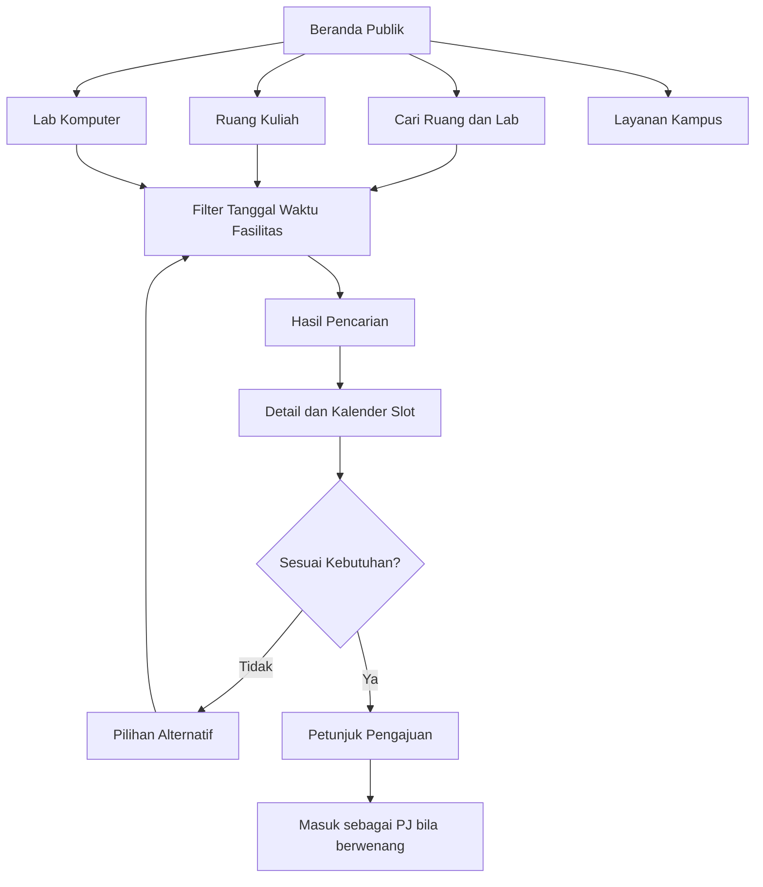
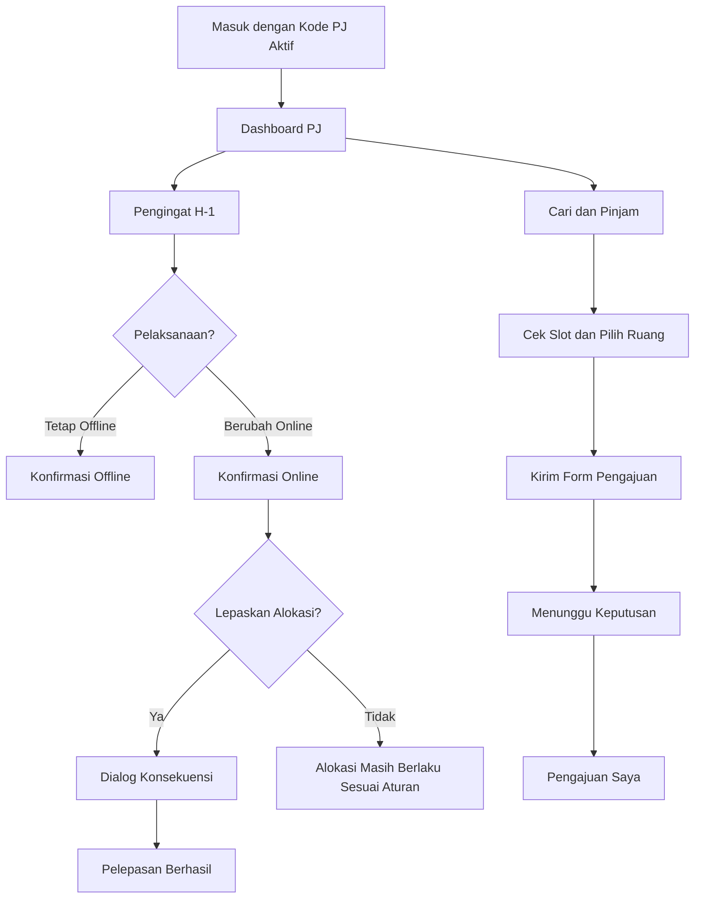
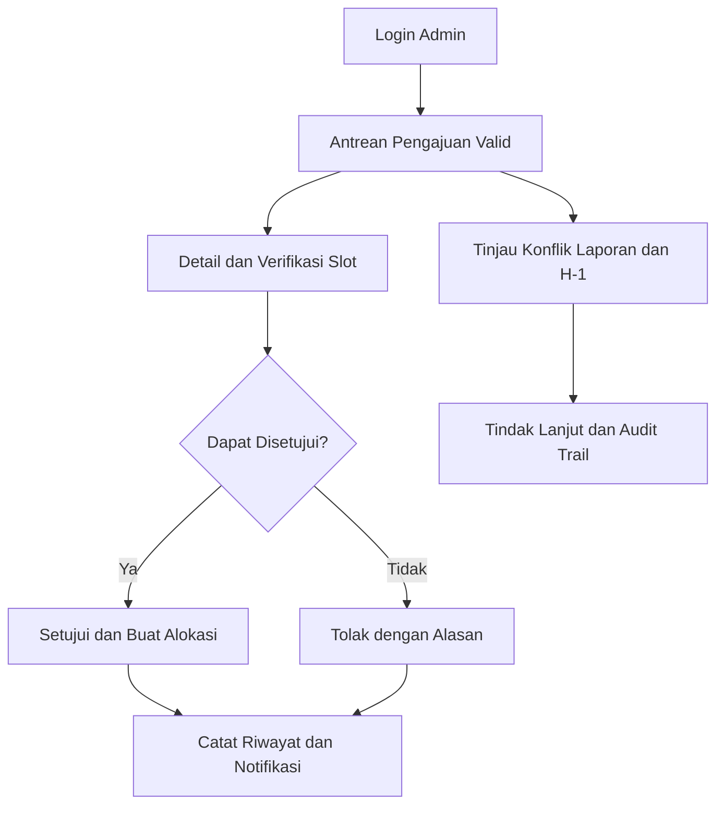

> **PRIORITAS DESAIN TERBARU — v6.7:** Sidebar Admin memiliki **10 halaman utama**, sidebar PJ **7 halaman utama**. Semua subfitur sejenis muncul sebagai **tab atau dialog** di halaman induknya, bukan halaman repetitif. Tab berganti cepat tanpa menampilkan overlay loading halaman. Referensi aktif: [SITEMAP-v6.7.md](SITEMAP-v6.7.md). Ketentuan dashboard dari v6.6 dan sebelumnya yang bertentangan digantikan oleh bagian ini.

# Adendum MATRA v6.6 — Struktur Navigasi Admin/PJ Terkini

Versi ini menghapus **9 subhalaman Admin** dan **14 subhalaman PJ** dari navigasi dashboard. Kelompok PJ **Jadwal & Konfirmasi** dinamai ulang menjadi **Konfirmasi**. Detail perubahan, nama dan rute yang dipertahankan tercantum pada [`SITEMAP-v6.6.md`](SITEMAP-v6.6.md).

**Aturan pembaruan:** bila dokumen desain/requirement versi terdahulu menyebut halaman yang sudah dihapus, spesifikasi navigasi **v6.6 menggantikannya**. Persyaratan peran, validasi, status slot, aturan alokasi resmi dan persetujuan Admin tetap berlaku. Aksi penting tetap berada dalam halaman yang bertahan (misalnya verifikasi/keputusan pada Antrean Pengajuan dan pembatalan di dalam Detail Pengajuan), bukan pada subhalaman tersendiri.

---

# Addendum desain MATRA v6.2 — Popup pencarian dan login

- Popup pencarian global memakai **React Portal** untuk menghindari pembatasan stacking context dari navbar sticky dan `backdrop-filter`. Backdrop menutupi keseluruhan viewport.
- Bidang input pencarian mempunyai satu gaya fokus yang konsisten, responsif untuk desktop/mobile. Background terkunci saat popup terbuka dan fokus keyboard terjaga.
- Dialog mendukung keyboard (`Ctrl + K`, panah, Enter, Escape, Tab) serta dapat ditutup dengan klik backdrop.
- Footer keterangan panjang pada form PJ/Admin dihapus tanpa mengubah field kode PJ maupun email/password Admin.
- Gaya visual, palet warna, aset WebP, dan animasi kuning versi sebelumnya tetap dipertahankan.

---

# Pembaruan Desain MATRA v5.0 — Editorial Illustration

**Visual yang diterapkan:** hero dua kolom seperti referensi portofolio, tipografi besar bergaya editorial, section dengan ruang putih lebih lega, tile ikon bergaris, kartu gambar seperti portofolio, proses peminjaman bertahap, navbar PJ dan footer Admin. **Identitas warna MATRA tetap:** teal `#006569`, deep teal `#00494B`, kuning `#FFDD00`, Poppins. Detail implementasi ada di `src/components/HomeExperience.jsx` dan `src/styles/v5.css`.

**Media manual:** foto dapat ditambahkan tanpa mengubah React pada folder `public/assets/foto/`, panduan `public/assets/foto/PANDUAN-FOTO.md`. Ikon UI memakai paket `lucide-react`, panduan di `ICON-GUIDE.md`.

---

# DESIGN.md — MATRA | Sistem Informasi Ruang dan Fasilitas Akademik

> **Dokumen spesifikasi UI/UX dan panduan high-fidelity untuk Desktop.** Cakupan: Halaman Publik, Dashboard PJ Mata Kuliah, dan Dashboard Admin. Dokumen ini merupakan spesifikasi desain, **bukan** klaim bahwa seluruh halaman telah diimplementasikan.
>
> **Versi acuan:** 25 Oktober 2026 · **Bahasa UI:** Indonesia · **Zona waktu tampilan:** WIB (Asia/Jakarta)

## 1. Overview & Vision

**MATRA** adalah website informasi dan pengelolaan fasilitas akademik di lingkungan **Rumpun Matematika, FMIPA Universitas Negeri Jakarta**. MATRA membantu mahasiswa memeriksa jadwal, ketersediaan ruang kuliah/lab komputer, serta informasi layanan kampus; membantu Penanggung Jawab (PJ) mengonfirmasi pelaksanaan perkuliahan, mengajukan ruang, dan menindaklanjuti keputusan; dan membantu admin mengelola jadwal, alokasi, persetujuan, serta konflik penggunaan ruang.

**Janji produk:** *"Temukan ruang. Pastikan jadwalnya."* Fokus desain bukan sekadar menampilkan ruangan kosong, melainkan menjelaskan **ketersediaan berdasarkan tanggal dan rentang waktu**, **alokasi resmi**, **konfirmasi PJ**, dan **keputusan peminjaman** sebagai hal yang berbeda.

### 1.1 Tujuan desain

1. Mempercepat proses menemukan ruang/lab yang sesuai dengan kebutuhan dan slot waktu.
2. Mengurangi bentrokan serta ketergantungan pada PDF jadwal dan koordinasi WhatsApp.
3. Membuat status slot, status permohonan, dan konfirmasi kelas mudah dibedakan.
4. Menonjolkan keputusan/tindakan berikutnya, khususnya bagi PJ dan admin.
5. Menjaga tampilan minimalis, modern, informatif, konsisten, serta responsif.
6. Mengikuti **tujuh prinsip Norman**: discoverability, feedback, mapping, consistency, error prevention, recognition rather than recall, dan flexibility/efficiency.

### 1.2 Dasar acuan dan batas interpretasi

| Sumber | Kontribusi terhadap desain | Status |
|---|---|---|
| `UTS(2).docx` | User research, user flow, kebijakan alokasi, metode evolutionary prototyping, palet, dan kebutuhan tiga peran | Acuan kebutuhan utama |
| Sitemap gambar `Halaman Publik(2).png`, `Halaman PJ.png`, `Halaman Admin.png` | Nama kelompok/menu dan cakupan subhalaman | Acuan struktur navigasi utama |
| [Figma MATRA — Page 3](https://www.figma.com/design/Ew0UZ1gAECgRFCMIaNGw69/Biologi-FMIPA-UNJ?node-id=243-40) | Komposisi, ukuran desktop, warna, tipografi, contoh komponen dan screen awal | Referensi high-fidelity yang sudah ada |
| `00  BERANDA PUBLIK.png`, `01  RUANG KULIAH.png` | Tampilan aktual beranda, daftar, detail, dan gaya UI yang diharapkan | Referensi visual aktual |
| Enam JSON Elementor yang disediakan | Pola container full width / inner 1160px, grid, whitespace, hover, serta adaptasi tablet/mobile | Referensi gaya dan responsivitas, **bukan** sumber fitur MATRA |
| Contoh `DESIGN.md` ChemistryLab | Struktur penulisan design system, komponen, interaksi, dan pemeriksaan desain | Hanya contoh kerangka; detail kimia/19 unsur UTS tidak diadopsi |

**Status Figma pada tanggal acuan:** Page 3 mempunyai **21 frame bernomor 00–20 untuk Publik**. Frame **00 Beranda Publik**, **01 Daftar Ruang Kuliah**, dan **02 Detail Ruang Kuliah** sudah berisi komposisi high-fidelity. Frame **03–20** sudah diberi nama tetapi masih kosong; halaman PJ/Admin dijabarkan di sitemap tetapi belum berupa desain lengkap di Page 3. Bagian yang belum digambar dalam Figma di bawah adalah **spesifikasi rancangan**, bukan deskripsi screen yang sudah selesai.

---

## 2. Prinsip Desain & Anti-Generic UI

| Prinsip | Yang diterapkan | Yang dihindari |
|---|---|---|
| Informasi sebelum dekorasi | Tanggal, jam, status, lokasi, dan aksi selalu terlihat jelas | Hero hiasan besar yang menutupi pencarian |
| Kejelasan status | Status punya **teks + warna + konteks**; tiga kelompok status dipisah | Label tunggal "Booking" untuk semua keadaan |
| Tanggung jawab jelas | Publik membaca; PJ bertindak atas penugasannya; admin memutuskan | Tombol mengubah jadwal tersedia bagi pengunjung umum |
| Alur efisien | Cari → lihat jadwal/detail → pilih slot → ajukan (PJ) → pantau | Form panjang sebelum pengguna mengetahui ketersediaan |
| UI autentik akademik | Konten ruangan nyata sebagai struktur, ikon gedung/jam/kalender sederhana | Istilah bombastis, ilustrasi AI generik, statistik tanpa data |
| Terbuka namun terlindungi | Jadwal publik bisa dibaca, tindakan berwenang perlu autentikasi | Membuka kode PJ, identitas pribadi, atau aksi admin ke publik |
| Konsisten lintas modul | Komponen filter, card, kalender, tombol, status, dialog dipakai ulang | Gaya berbeda drastis antara Ruang Kuliah dan Lab Komputer |
| Aksesibilitas | Label jelas, kontras memadai, fokus keyboard, status tidak hanya warna | Ikon tanpa nama, teks placeholder sebagai satu-satunya label |

---

## 3. Design System: Warna, Tipografi, Spasi, dan Grid

### 3.1 Palet dan design tokens

Warna prioritas sesuai dokumen MATRA; nilai pendukung dipilih dari komposisi Figma dan dapat distandardisasi sebagai CSS variables / Figma Variables.

| Token | HEX | Peran |
|---|---|---|
| `--matra-primary` | `#006569` | Brand, navigasi aktif, aksi utama, ringkasan alokasi |
| `--matra-primary-deep` | `#00494B` | Judul hero, footer gelap, hover tombol utama |
| `--matra-accent` | `#FFDD00` | Sorotan brand/ilustrasi; **bukan** indikator status |
| `--matra-surface` | `#FFFFFF` | Latar utama dan kartu penting |
| `--matra-surface-muted` | `#F2F5F7` | Panel pencarian, filter, kartu fasilitas |
| `--matra-surface-teal` | `#E6F4F3` | Panel penjelasan, hero ilustrasi, informasi kebijakan |
| `--matra-text-title` | `#17324D` | Heading dan teks hierarki tinggi |
| `--matra-text-body` | `#334155` | Isi teks dan detail data |
| `--matra-text-muted` | `#64748B` | Keterangan, breadcrumb nonaktif, metadata |
| `--matra-border` | `#DCE5E8` | Batas kartu, divider, form input |
| `--matra-success` | `#15803D` | Tersedia, Disetujui |
| `--matra-danger` | `#B42318` | Konflik, Ditolak, tindakan destruktif |
| `--matra-warning` | `#A16207` | Menunggu Keputusan, peringatan tindak lanjut |
| `--matra-info` | `#1D4ED8` | Berubah Online, notifikasi informasional |
| `--matra-neutral` | `#64748B` | Tidak Tersedia, Dibatalkan, Belum Dikonfirmasi |
| `--matra-allocated-soft` | `#67C6BE` | Latar tint/pelengkap visual status Dialokasikan |

**Penting mengenai perbedaan sumber:** Tabel status pada dokumen UTS memakai `#006569` untuk **Dialokasikan**, sedangkan penjelasan konsistensi/high-fidelity menyebut `#67C6BE`. Agar **tidak menghapus perbedaan ini secara diam-diam**, spesifikasi awal menetapkan `#006569` untuk teks/icon/penekanan dan `#67C6BE` sebagai tint latar. Konvensi final perlu disahkan saat review desain. Selalu pastikan rasio kontras label pada latar yang dipilih.

Contoh implementasi token:

```css
:root {
  --matra-primary: #006569;
  --matra-primary-deep: #00494B;
  --matra-accent: #FFDD00;
  --matra-surface: #FFFFFF;
  --matra-surface-muted: #F2F5F7;
  --matra-surface-teal: #E6F4F3;
  --matra-text-title: #17324D;
  --matra-text-body: #334155;
  --matra-text-muted: #64748B;
  --matra-border: #DCE5E8;
  --matra-success: #15803D;
  --matra-danger: #B42318;
  --matra-warning: #A16207;
  --matra-info: #1D4ED8;
  --matra-neutral: #64748B;
  --matra-allocated-soft: #67C6BE;
}
```

### 3.2 Tiga status yang harus dipisah

**A. Ketersediaan slot — bergantung pada ruangan, tanggal, dan interval waktu.**

| Status | Label | Warna indikator | Makna UI |
|---|---|---|---|
| Tersedia | `Tersedia` | Hijau `#15803D` | Slot dapat diajukan sesuai aturan |
| Dialokasikan | `Dialokasikan` | Teal `#006569` | Slot dilindungi karena jadwal resmi/peminjaman yang disetujui |
| Tidak Tersedia | `Tidak tersedia` | Abu-abu `#64748B` | Slot tidak dapat dipakai, misalnya ruang ditutup/di luar ketentuan |
| Konflik | `Konflik` | Merah `#B42318` | Ada pertentangan informasi jadwal atau klaim penggunaan; butuh penanganan |

**B. Status peminjaman — menggambarkan keputusan atas satu pengajuan.**

| Status | Warna | Aksi/keterangan |
|---|---|---|
| Menunggu Keputusan | Amber `#A16207` | Permohonan diterima, belum ada persetujuan |
| Disetujui | Hijau `#15803D` | Alokasi sah untuk rentang waktu yang disetujui |
| Ditolak | Merah `#B42318` | Tampilkan alasan penolakan dan alternatif bila ada |
| Dibatalkan | Abu-abu `#64748B` | Pengajuan tidak dilanjutkan; tampilkan jejak pembatalan |

**C. Konfirmasi pelaksanaan PJ — menggambarkan moda pertemuan, bukan status booking.**

| Status | Warna | Keterangan |
|---|---|---|
| Belum Dikonfirmasi | Abu-abu `#64748B` | PJ belum menjawab pengingat H-1; alokasi resmi **tetap terlindungi** |
| Tetap Offline | Teal `#006569` | PJ menegaskan kelas menggunakan ruang sesuai alokasi |
| Berubah Online | Biru `#1D4ED8` | PJ menyatakan pelaksanaan online; pelepasan alokasi tetap merupakan aksi eksplisit dengan dialog konfirmasi |

Jangan memakai satu badge untuk menyimpulkan ketiganya. Contoh satu baris slot yang benar:

> **GDS 607 · Senin, 26 Okt 2026 · 09.00–11.00 WIB** — Slot: **Dialokasikan** · Pelaksanaan: **Belum Dikonfirmasi** · Pemegang alokasi: **kelas yang terjadwal**.

### 3.3 Tipografi dan hierarki

Figma Page 3 memakai **Poppins**. Ukuran berikut mengikuti nilai yang teramati pada tiga layar aktif dan melengkapinya untuk komponen yang belum didesain.

| Kegunaan | Desktop | Bobot / line-height | Sumber |
|---|---|---|---|
| Hero beranda | `44px` | SemiBold / ±1.15 | Teramati di Figma |
| Judul halaman (`h1`) | `32px` | SemiBold / ±1.25 | Teramati di daftar/detail |
| Judul bagian (`h2`) | `24px` | SemiBold / ±1.3 | Teramati di beranda |
| Judul card (`h3`) | `18px` | SemiBold / ±1.4 | Teramati di beranda |
| Body utama | `14px`–`16px` | Regular / 1.55–1.75 | 14px dominan di Figma; 16px untuk teks panjang bila memungkinkan |
| Label/metadata | `12px` | Medium/SemiBold / 1.4 | Teramati di Figma |
| Detail sekunder | `11px`–`12px` | Regular / 1.4 | Batasi untuk caption ringkas, bukan informasi penting |
| Kode/nomor pengajuan | `13px`–`14px` | Medium; angka tabular | Rekomendasi |

Gunakan kontras dan bobot lebih dulu sebelum memperbanyak ukuran font. Hindari teks body yang terlalu kecil pada panel filter dan tabel.

### 3.4 Spacing, ukuran, dan permukaan

| Elemen | Spesifikasi |
|---|---|
| Frame desktop rancangan awal | `1440px` lebar, tinggi menurut isi; jangan memotong layar pada 930px |
| Lebar konten publik | `max-width: 1160px`, rata tengah; di frame 1440px berarti margin kiri/kanan ±140px |
| Latar section | Full viewport-width; isi section tetap `max-width:1160px` |
| Header publik | Dua lapis: utility strip + navigasi utama; total ±111px pada layar aktif Figma |
| Hero publik | Dua kolom teks dan ilustrasi; area teks lebih lebar daripada ilustrasi |
| Grid daftar fasilitas | Panel filter kiri ±248px; hasil kanan menggunakan sisa ruang, gap ±24px |
| Grid hasil Ruang Kuliah | Dua kartu/row pada area hasil di contoh layar daftar |
| Kartu layanan beranda | Tiga kolom, gap ±24px; card ±370px pada konten 1160px |
| Layout dua kolom formulir/detail | Gunakan grid fleksibel sesuai konten; jangan memakai pembagian 50:50 bila label/status padat |
| Spacing dasar | Kelipatan `4px`; umum `8/12/16/20/24/32/48/64/80px` |
| Radius kontrol | `8px`–`10px`; radius card `12px`–`16px`; gambar `16px` |
| Tombol | Tinggi sekitar `44px`–`48px`; padding horizontal `18px`–`24px` |
| Shadow | Ringan, hanya untuk kedalaman; border halus lebih penting daripada bayangan tebal |

**Layout dashboard PJ/Admin:** pendekatan **sidebar navigasi + topbar + area kerja** direkomendasikan untuk banyak menu dan tabel. Lebar sidebar awal **240–260px** merupakan *usulan desain*, bukan ukuran yang sudah ada di Figma MATRA. Sidebar pada Figma sistem peminjaman ruangan lain digunakan hanya sebagai pola referensi, bukan identitas visual yang harus disalin.

---

## 4. Struktur Global dan Navigasi per Peran

### 4.1 Shell publik

1. **Utility bar:** “FMIPA Universitas Negeri Jakarta” di kiri dan konteks “Informasi fasilitas akademik · Akses publik” di kanan.
2. **Header utama:** logo MATRA, `Ruang Kuliah`, `Lab Komputer`, `Cari Ruang & Lab`, `Layanan Kampus`, tombol utama `Masuk sebagai PJ`.
3. **Breadcrumb:** lokasi halaman dan tautan kembali; selalu tampil pada halaman isi.
4. **Konten:** judul halaman, filter/jadwal/informasi sesuai tugas, tanpa sidebar global permanen.
5. **Footer:** identitas MATRA, tagline “Informasi ruang, lebih pasti.”, `Petunjuk peminjaman`, `Layanan kampus`, `Login admin`, dan atribusi institusi.

Menu `Lihat kalender` pada hero langsung mengarahkan ke kalender ketersediaan; akses lihat jadwal tidak meminta akun.

### 4.2 Shell PJ

- Header identitas penugasan: nama PJ (setelah masuk), kelas/prodi/semester, masa aktif kode (jika tersedia), pemberitahuan, aksi keluar.
- Menu sidebar dikelompokkan sesuai sitemap: **Dashboard PJ**, **Jadwal & Konfirmasi**, **Cari & Pinjam**, **Pengajuan Saya**, **Akses & Dukungan**.
- Konten utama menempatkan **tindakan mendesak di bagian atas**: pengingat H-1, pengajuan yang perlu dipantau, laporan yang berubah.
- Data dan tombol bersifat **scope-of-authority**: PJ tidak dapat mengubah kelas atau alokasi orang lain.

### 4.3 Shell Admin

- Login terpisah dengan kredensial admin, **bukan** kode akses PJ.
- Sidebar sesuai sitemap: **Beranda Admin**, **Peminjaman**, **Jadwal & Alokasi**, **Kelola Fasilitas**, **PJ & Kode Akses**, **Laporan & Tindak Lanjut**.
- Topbar memuat pencarian terbatas lingkup admin, notifikasi, identitas operator, dan akses keluar.
- Informasi yang memerlukan tindakan (pengajuan menunggu, konflik, konfirmasi H-1, laporan masuk) lebih ditonjolkan daripada grafik dekoratif.
- Tabel memiliki pencarian, filter status/tanggal/prodi/gedung, sorting yang relevan, dan pagination saat data panjang.

---

## 5. Spesifikasi 21 Layar Publik — Figma Page 3

### 5.1 Inventaris layar

| No. | Nama frame di Figma | Area sitemap | Status rancangan |
|---|---|---|---|
| 00 | Beranda Publik | Pintu masuk | **Sudah didesain** |
| 01 | Daftar Ruang Kuliah | Ruang Kuliah | **Sudah didesain** |
| 02 | Detail Ruang Kuliah | Ruang Kuliah | **Sudah didesain** |
| 03 | Kalender Ruang Kuliah | Ruang Kuliah | Kerangka kosong |
| 04 | Detail Status Slot | Ruang Kuliah | Kerangka kosong |
| 05 | Info Konfirmasi PJ | Ruang Kuliah | Kerangka kosong |
| 06 | Daftar Lab Komputer | Lab Komputer | Kerangka kosong |
| 07 | Detail Lab Komputer | Lab Komputer | Kerangka kosong |
| 08 | Software Laboratorium | Lab Komputer | Kerangka kosong |
| 09 | Kalender Lab Komputer | Lab Komputer | Kerangka kosong |
| 10 | Waktu Pemeriksaan | Lab Komputer | Kerangka kosong |
| 11 | Cari Ruang & Lab | Pencarian Bersama | Kerangka kosong |
| 12 | Filter Pencarian | Pencarian Bersama | Kerangka kosong |
| 13 | Filter Waktu | Pencarian Bersama | Kerangka kosong |
| 14 | Hasil & Alternatif | Pencarian Bersama | Kerangka kosong |
| 15 | Kalender Ketersediaan | Pencarian Bersama | Kerangka kosong |
| 16 | Direktori Layanan Kampus | Layanan & Akses | Kerangka kosong |
| 17 | Detail Layanan | Layanan & Akses | Kerangka kosong |
| 18 | Masuk sebagai PJ | Layanan & Akses | Kerangka kosong |
| 19 | Login Admin | Layanan & Akses | Kerangka kosong |
| 20 | Petunjuk Peminjaman | Layanan & Akses | Kerangka kosong |

### 5.2 Layar 00 — Beranda Publik **(mengikuti desain aktual)**

**Urutan visual dari atas ke bawah:**

1. Utility bar dan header publik (menu horizontal, CTA PJ).
2. Breadcrumb `Beranda / Halaman publik`.
3. **Hero dua kolom**: badge `RUANG KAMPUS, DALAM SATU TEMPAT`; heading “Temukan ruang. Pastikan jadwalnya.”; kalimat deskriptif; CTA `Cari ruang & lab` dan `Lihat kalender`; ilustrasi gedung geometris teal-kuning berlatar teal pucat.
4. **Quick search** di panel abu-abu terang: `Tanggal`, `Waktu mulai`, `Waktu selesai`, tombol `Cari ketersediaan`.
5. Heading “Apa yang kamu butuhkan?” dan **tiga service cards** `Ruang Kuliah`, `Lab Komputer`, `Layanan Kampus`; masing-masing ikon, angka 01/02/03, ringkasan, `Jelajahi layanan`.
6. Notice teal muda: “Informasi terbuka, pengajuan sesuai kewenangan” dan penjelasan akses publik vs PJ.
7. Footer gelap teal.

**Interaksi:** Quick search harus meneruskan nilai tanggal dan interval waktu ke halaman pencarian hasil; CTA tidak boleh dead-end. Tampilkan validasi bila waktu selesai ≤ waktu mulai. Tanggal/waktu pada desain adalah **contoh visual**, bukan data ketersediaan live.

### 5.3 Layar 01 — Daftar Ruang Kuliah **(mengikuti desain aktual)**

- Breadcrumb dan identitas bagian `FASILITAS PERKULIAHAN`, judul “Ruang yang tepat untuk kelasmu.”
- Bar pencarian tanggal, waktu mulai, waktu selesai, CTA `Cari ketersediaan`.
- Panel filter kiri: **Gedung, Kapasitas, Lantai, Fasilitas** (`Proyektor`, `AC`, `Wi-Fi`, `Papan tulis`), `Terapkan filter`, `Reset filter`.
- Kolom hasil kanan: jumlah hasil (`4 ruang kuliah ditemukan` dalam contoh), opsi ke kalender, grid **dua kolom** room cards.
- Room card memuat nama/gedung/lantai, atribut ringkas, **status berdasarkan interval terpilih**, rentang waktu, dan `Lihat detail`.
- Notice menegaskan status berlaku untuk waktu pencarian, bukan sepanjang hari.
- Jika nol hasil: empty state, penjelasan filter, `Ubah waktu` / `Cari alternatif`.

### 5.4 Layar 02 — Detail Ruang Kuliah **(mengikuti desain aktual)**

- Breadcrumb sampai `GDS 607`, judul `Ruang GDS 607`, subteks `Gedung Dewi Sartika • Lantai 6`.
- Ringkasan kapasitas, lantai dan fasilitas utama; tombol menuju kalender / pemeriksaan status.
- Ilustrasi jadwal/ruang dalam panel kanan; chips fasilitas (contoh: Proyektor, AC, Wi-Fi, Papan tulis).
- Area detail lokasi, akses dan keterangan; panel slot per tanggal/jam dengan status tegas.
- Tindakan lanjutan berorientasi **lihat detail jadwal**. Jika pengunjung ingin mengajukan, jelaskan bahwa aksi membutuhkan akses PJ, bukan langsung melakukan booking publik.

### 5.5 Layar 03–05 — Kalender, Detail Slot, Info Konfirmasi PJ

- **03 Kalender Ruang Kuliah:** filter gedung/kelas/tanggal, pengubah pekan/bulan, grid hari dan sesi, legenda empat status ketersediaan, item kalender yang membuka detail slot. Tambahkan ringkasan pola kelas: offline tiap pekan, online tiap pekan, bergantian, atau khusus bila datanya tersedia.
- **04 Detail Status Slot:** panel identitas ruang/tanggal/rentang waktu, satu badge **status slot**, sumber alokasi (jadwal resmi/peminjaman disetujui bila dapat dipublikasikan), kelas penanggung jawab jika sesuai kebijakan, keterangan konflik/ketidaktersediaan, dan tautan ke alternatif.
- **05 Info Konfirmasi PJ:** informasi **Belum Dikonfirmasi / Tetap Offline / Berubah Online** terpisah dari status slot; jelaskan bahwa belum dikonfirmasi **tidak berarti tersedia**. Publik hanya membaca; tombol konfirmasi tidak ada pada area publik.

### 5.6 Layar 06–10 — Lab Komputer

- **06 Daftar Lab Komputer:** kartu tiap lab dengan gedung, lantai, kapasitas, jumlah PC berfungsi, status slot, fasilitas utama, dan tautan detail.
- **07 Detail Lab Komputer:** informasi peminjaman **satu lab utuh**, lokasi, kapasitas, komputer berfungsi, fasilitas, daftar perangkat lunak, jadwal dan catatan pemeriksaan.
- **08 Software Laboratorium:** daftar aplikasi/IDE/compiler yang disediakan; tampilkan nama dan versi **hanya jika datanya tersedia**; cari/filter bila daftar panjang.
- **09 Kalender Lab Komputer:** timeline yang konsisten dengan ruang kuliah; satu interval lab yang dialokasikan tidak dibagi menjadi booking komputer individual.
- **10 Waktu Pemeriksaan:** tampilkan tanggal/waktu pemeriksaan fasilitas terakhir, ringkasan kondisi, sumber/penanggung jawab bila boleh ditampilkan, dan penanda “belum ada data” jika pemeriksaan belum tercatat.

### 5.7 Layar 11–15 — Pencarian Bersama

- **11 Cari Ruang & Lab:** pencarian satu pintu dengan pemilihan jenis `Ruang Kuliah` / `Lab Komputer` / `Semua` (proposal komponen); input tanggal serta rentang waktu.
- **12 Filter Pencarian:** parameter jenis, gedung, lokasi/lantai, kapasitas, fasilitas. Saat tipe lab dipilih, izinkan filter software/kebutuhan perangkat.
- **13 Filter Waktu:** tanggal, mulai, selesai, dan tampilan sesi kelas apabila jadwal menggunakan sesi; cegah interval yang tidak valid.
- **14 Hasil & Alternatif:** daftar kecocokan + alasan tiap hasil; bila tidak tersedia, tampilkan ruang alternatif atau waktu terdekat **hanya dari data yang telah diverifikasi**, tanpa mengklaim slot sebagai pasti tersedia jika belum dicek.
- **15 Kalender Ketersediaan:** tampilan lintas ruang/lab dengan legenda status konsisten, kontrol periode, klik sel → detail status.

### 5.8 Layar 16–20 — Layanan & Akses

- **16 Direktori Layanan Kampus:** kategori dan daftar fasilitas/layanan; kartu nama, lokasi, jam layanan ringkas, link detail; tidak membuat booking layanan atau antrean digital pada tahap awal.
- **17 Detail Layanan:** nama, deskripsi, lokasi, jam operasional, persyaratan, kontak yang memang disetujui untuk publikasi; tidak tampilkan nomor pribadi tanpa izin.
- **18 Masuk sebagai PJ:** halaman kode akses unik yang diberikan admin; petunjuk singkat masa berlaku, pesan kode salah/kedaluwarsa, jalur bantuan admin. **Bukan** formulir registrasi terbuka.
- **19 Login Admin:** halaman kredensial terpisah, label/validasi aman, bantuan jika gagal. Sembunyikan petunjuk kode PJ dalam formulir admin.
- **20 Petunjuk Peminjaman:** alur `Cari → Periksa Jadwal → Masuk sebagai PJ → Ajukan → Menunggu Keputusan → Lihat Hasil`; jelaskan batasan pengajuan mahasiswa umum dan jalur bantuan pengelola.

---

## 6. Dashboard PJ — Seluruh Kelompok Sitemap

**Catatan:** Modul PJ berikut belum berupa layar lengkap di Figma Page 3. Komposisi di bawah adalah panduan pembangunan high-fidelity sesuai sitemap.

### 6.1 Dashboard PJ — Ringkasan dan prioritas harian

| Halaman | Komposisi desktop | Interaksi utama |
|---|---|---|
| Beranda PJ | Sapaan, periode/semester, ringkasan jadwal hari ini, slot tanggung jawab, panel prioritas | Buka jadwal / lihat pengingat |
| Kelas Tanggung Jawab | Tabel/kartu mata kuliah, prodi, kelas, semester, sesi, ruang | Lihat detail pertemuan |
| Pengingat H-1 | Daftar pertemuan yang perlu konfirmasi dengan deadline/slot | `Konfirmasi pelaksanaan` |
| Notifikasi | Feed perubahan keputusan, konflik dan pembaruan dengan waktu kejadian | Buka objek terkait, tandai telah dibaca |
| Info Penugasan | Identitas penugasan dan masa aktif kode | Baca ketentuan, kontak admin bila ada ketidaksesuaian |

### 6.2 Jadwal & Konfirmasi — Setiap pertemuan sesuai kelas

| Halaman | Komposisi desktop | Interaksi utama |
|---|---|---|
| Jadwal Saya | Kalender/tabel jadwal kelas yang ditugaskan; filter tanggal/mata kuliah | Buka pertemuan |
| Detail Pertemuan | Mata kuliah, kelas, tanggal/sesi, ruang, pola online/offline, alokasi | Lihat konfirmasi dan status slot |
| Konfirmasi Pelaksanaan | Card dua opsi `Tetap Offline` / `Berubah Online` dan konteks | Simpan konfirmasi sesuai otorisasi |
| Lepaskan Alokasi | Ringkasan konsekuensi, dialog konfirmasi eksplisit | `Ya, lepaskan alokasi` atau kembali |
| Status Alokasi | Badge alokasi resmi dan status konfirmasi berbeda, kronologi singkat | Buka detail/alasan |

**UX kritis:** apabila PJ tidak merespons H-1, tampilkan “Belum Dikonfirmasi”, tetapi status slot **tetap Dialokasikan**. Saat berubah online, jangan menganggap slot telah dilepas sebelum aksi pelepasan berhasil dan hasilnya tersimpan. Setelah alokasi dilepas lalu disetujui untuk pihak lain, tampilkan bahwa PJ sebelumnya **tidak dapat mengambilnya kembali sepihak**.

### 6.3 Cari & Pinjam — Akses pencarian untuk PJ

| Halaman | Komposisi desktop | Interaksi utama |
|---|---|---|
| Cari Ruang / Lab | Filter tanggal, mulai–selesai, lokasi, kapasitas, fasilitas/software | Cari slot dan tampilkan hasil |
| Detail & Kalender | Detail ruang/lab, timeline dan status pada interval terpilih | Pilih ruang/waktu layak |
| Formulir Pengajuan | Ringkasan slot yang tidak dapat diubah tanpa cek ulang, kelas/PJ, alasan, kebutuhan | `Kirim pengajuan` |
| Pilihan Alternatif | Kartu ruang atau waktu alternatif beserta perbedaan kapasitas/fasilitas | Pilih lalu cek ulang status |
| Lapor Ketidaksesuaian | Form ruang, tanggal, sesi, masalah, keterangan | Kirim laporan untuk admin |

**UX kritis:** kirim form **bukan** persetujuan otomatis. Setelah submit, tampilkan nomor pengajuan dan badge **Menunggu Keputusan**. Jika status slot berubah selama pengisian, tampilkan validasi terbaru dan arahkan ke alternatif.

### 6.4 Pengajuan Saya — Permintaan dan keputusan

| Halaman | Komposisi desktop | Interaksi utama |
|---|---|---|
| Pengajuan Aktif | Daftar `Menunggu Keputusan` dan `Disetujui`, tanggal, lokasi, slot | Lihat detail |
| Detail Pengajuan | Nomor, waktu diterima, ruang, alasan, status, keputusan admin | Lihat keputusan / tindak lanjut |
| Riwayat Pengajuan | Daftar seluruh status termasuk ditolak/dibatalkan | Filter status/periode |
| Alasan Penolakan | Penjelasan penolakan beserta opsi penyesuaian | Buka alternatif dan ajukan ulang |
| Batalkan Pengajuan | Dialog konfirmasi, ringkasan dampak, pesan hasil | Konfirmasi pembatalan sesuai aturan |

### 6.5 Akses & Dukungan — Batasan peran

| Halaman | Komposisi desktop | Interaksi utama |
|---|---|---|
| Identitas & Penugasan | Identitas singkat, prodi, mata kuliah, kelas, semester | Lihat masa aktif |
| Kode Tidak Berlaku | Empty/error state kode kedaluwarsa/dicabut | Hubungi admin; kembali ke publik |
| Pengajuan Mendesak | Petunjuk bahwa kasus mendesak ditangani admin secara langsung | Lihat kontak/petunjuk resmi |
| Status Perubahan | Ringkasan bahwa hak peminjam lain yang sudah disetujui tetap terlindungi | Cari opsi baru |
| Keluar Dashboard PJ | Konfirmasi keluar bila dibutuhkan, lalu kembali ke publik | Keluar secara aman |

---

## 7. Dashboard Admin — Seluruh Kelompok Sitemap

**Catatan:** Modul admin berikut belum berupa layar lengkap di Figma Page 3. Gunakan gaya visual MATRA, namun optimalkan untuk operasi berbasis tabel, antrean, kalender, dan audit trail.

### 7.1 Beranda Admin — Prioritas penanganan

| Halaman | Komponen yang ditampilkan | Tindakan |
|---|---|---|
| Ringkasan Dashboard | KPI operasional yang benar-benar bersumber data (menunggu, konflik, belum konfirmasi, laporan) | Klik membuka daftar terfilter |
| Pengajuan Menunggu | Antrean pengajuan valid | Verifikasi dan putuskan |
| Konflik Jadwal | Ruangan/waktu yang bertabrakan | Tinjau konflik |
| Konfirmasi H-1 | PJ yang belum merespons | Tinjau konteks dan tindak lanjuti |
| Laporan Masuk | Laporan ketidaksesuaian baru | Buka detail laporan |

### 7.2 Peminjaman — Antrean, keputusan, riwayat

| Halaman | Komponen yang ditampilkan | Tindakan |
|---|---|---|
| Antrean Pengajuan | Nomor urut, waktu diterima server, ruang, slot, PJ, status | Buka detail paling awal yang valid |
| Detail & Verifikasi | Detail form, benturan jadwal, alokasi saat ini, fasilitas | Periksa kelayakan saat memutuskan |
| Keputusan Pengajuan | Pilihan setujui/tolak, alasan, preview dampak | Simpan keputusan atomik dan informasikan |
| Riwayat Pengajuan | Filter tanggal, status, petugas, nomor, perubahan | Buka audit keputusan |
| Alternatif & Tindak Lanjut | Daftar opsi slot/ruang ketika permohonan tidak dapat dilayani | Sampaikan alternatif kepada PJ |

### 7.3 Jadwal & Alokasi — Sumber jadwal resmi

| Halaman | Komponen yang ditampilkan | Tindakan |
|---|---|---|
| Daftar Jadwal Resmi | Kelas, ruang, hari, sesi, semester, prodi | Filter/detail |
| Tambah / Ubah Jadwal | Form alokasi resmi dan informasi kelas | Validasi konflik sebelum simpan |
| Pola Tiap Kelas | `offline tiap minggu`, `online tiap minggu`, `bergantian`, `khusus` | Tentukan pola sesuai jadwal resmi |
| Kalender Bersama | View ruangan dan lab lintas program studi | Audit alokasi dan konflik |
| Tinjauan Konflik | Pasangan jadwal/permohonan yang bertabrakan, konteks | Catat resolusi dan notifikasi |

### 7.4 Kelola Fasilitas — Ruang dan kondisi operasional

| Halaman | Komponen yang ditampilkan | Tindakan |
|---|---|---|
| Daftar Ruang Kuliah | Gedung, lantai, kapasitas, fasilitas, status operasional | Ubah data fasilitas |
| Daftar Lab Komputer | PC berfungsi, software, kapasitas, pemeriksaan terakhir | Ubah data lab dan pemeriksaan |
| Penutupan Ruang | Alasan tutup, waktu mulai/selesai, ruang terdampak | Cegah alokasi pada masa penutupan |
| Pemindahan Alokasi | Detail alokasi lama/baru dan dampaknya | Validasi ruang target dan notifikasi |
| Riwayat Perubahan | Log waktu, operator, nilai sebelum/sesudah | Audit riwayat |

### 7.5 PJ & Kode Akses — Masa tugas berbasis semester

| Halaman | Komponen yang ditampilkan | Tindakan |
|---|---|---|
| Daftar Penugasan PJ | Identitas, prodi, kelas, mata kuliah, semester | Buka/ubah penugasan |
| Semester & Masa Aktif | Mulai/akhir penugasan dan zona waktu WIB | Atur periode tugas |
| Terbitkan Kode Unik | Kode PJ baru untuk penugasan yang valid | Buat/distribusi secara aman |
| Ganti / Cabut Kode | Status kode, alasan pencabutan, masa berlaku | Rotasi/revoke akses |
| Riwayat Penugasan | Data penugasan lama termasuk keputusan yang terkait | Baca arsip tanpa menghapus data historis |

### 7.6 Laporan & Tindak Lanjut — Pemeriksaan kasus

| Halaman | Komponen yang ditampilkan | Tindakan |
|---|---|---|
| PJ Belum Konfirmasi | Daftar H-1 tanpa respons dengan status slot terlindungi | Tindak lanjut tanpa melepas otomatis |
| Laporan Ketidaksesuaian | Nomor, ruangan, waktu, pelapor, deskripsi | Buka laporan |
| Detail Tindak Lanjut | Temuan, bukti/keterangan, catatan koreksi | Catat solusi oleh admin |
| Notifikasi Terdampak | Daftar penerima informasi perubahan keputusan/alokasi | Kirim/publikasi notifikasi relevan |
| Riwayat Keputusan | Siapa, kapan, apa yang diubah, alasan | Audit trail tidak boleh hilang dari tampilan historis |

---

## 8. Library Komponen dan Interaksi

| Komponen reusable | Isi minimum | States yang harus ada |
|---|---|---|
| `Header/Public` | Brand, 4 navigasi, akses PJ, utility bar | Default, active menu, responsive menu |
| `Sidebar/Dashboard` | Logo, kelompok navigasi, identitas, keluar | Active, hover, collapsed |
| `Breadcrumb` | Parent links + current page | Default, focus |
| `Button` | Primer, sekunder/outline, teks, destruktif | Default, hover, focus, disabled, loading |
| `Input` | Label, hint, nilai, bantuan | Empty, filled, focus, error, disabled |
| `DateTimeRangePicker` | Tanggal, mulai, selesai, zona WIB | Normal, invalid interval, no slot |
| `FacilityCard` | Nama, lokasi, kapasitas/fasilitas, status, aksi | Available, allocated, unavailable, conflict |
| `StatusBadge` | Label penuh + warna semantik | Tiga keluarga berbeda (slot, permohonan, konfirmasi) |
| `FilterPanel` | Gedung/lantai/kapasitas/fasilitas, apply/reset | Applied, empty results, reset |
| `ScheduleCalendar` | Hari/tanggal/sesi, status slot, legenda | Today, selected, unavailable, conflict |
| `DataTable` | Kolom operasional dan aksi kontekstual | Loading, empty, error, paginated |
| `Notice` | Ikon, judul, penjelasan, CTA bila perlu | Info, success, warning, error |
| `NotificationList` | Pesan, waktu, tautan objek | Unread/read, empty |
| `ConfirmDialog` | Dampak aksi, tombol aman + destruktif | Open, pending, success/error |
| `EmptyState` | Alasan jelas + saran pengganti | No results, no permission, expired code |
| `LoadingSkeleton` | Struktur layar sementara menunggu data | Tidak menampilkan status/kepastian palsu |

### 8.1 Aturan tombol

- **Primer:** latar teal, teks putih, fokus pada satu aksi utama per area.
- **Sekunder:** outline teal di atas putih, untuk `Lihat kalender`, `Reset filter`, `Kembali`.
- **Destruktif:** merah khusus `Batalkan`, `Cabut kode`, atau tindakan berkonsekuensi lain; wajib dialog konfirmasi.
- **Disabled:** alasan dapat diketahui (misalnya slot tidak tersedia, kode PJ kedaluwarsa), bukan hanya opasitas.
- Hover/transisi bersifat ringan; mengikuti preferensi `prefers-reduced-motion`; hindari animasi otomatis yang mengganggu.

### 8.2 Form dan feedback

- Label permanen di atas input, placeholder hanya contoh.
- Format tanggal ditulis jelas; seluruh waktu operasional dalam **WIB**.
- Kesalahan ditampilkan dekat field, bukan hanya toast yang lenyap cepat.
- Submit menghasilkan feedback yang membedakan **permohonan diterima** dari **permohonan disetujui**.
- Saat filter berubah, hasil/jumlah hasil dan konteks tanggal/waktu ikut diperbarui; jangan mempertahankan badge status usang.
- Untuk keputusan admin, tampilkan ringkasan objek dan konsekuensi sebelum aksi final.
- Notifikasi dan status terhubung ke item asal; pengguna dapat kembali ke konteks tanpa mengulang pencarian.

### 8.3 Pesan (microcopy) penting

| Kondisi | Copy yang direkomendasikan |
|---|---|
| Tidak ada hasil | “Belum ada ruang yang cocok pada waktu ini. Ubah filter atau lihat alternatif.” |
| Alokasi resmi belum dikonfirmasi | “Slot dialokasikan sesuai jadwal resmi. PJ belum mengonfirmasi pelaksanaan.” |
| Form PJ terkirim | “Pengajuan berhasil dikirim. Status: Menunggu Keputusan.” |
| Permohonan disetujui | “Pengajuan disetujui. Ruang telah dialokasikan untuk waktu yang tercantum.” |
| Konfirmasi H-1 belum ada | “Belum dikonfirmasi. Alokasi ruangan tetap berlaku.” |
| Pelepasan alokasi | “Melepaskan alokasi memungkinkan ruangan diajukan pengguna lain. Tindakan ini tidak otomatis dapat dibatalkan.” |
| Kode PJ kedaluwarsa | “Kode akses tidak berlaku. Hubungi admin untuk memeriksa penugasan.” |
| Bentrokan | “Ada konflik jadwal pada interval ini. Lihat detail dan pilihan alternatif.” |

---

## 9. Diagram User Flow Prioritas

### 9.1 Publik: informasi tanpa login



### 9.2 PJ: konfirmasi dan pengajuan



### 9.3 Admin: antrean yang terverifikasi



---

## 10. Responsive Strategy dan Perilaku Layout

**Prioritas implementasi:** desktop lebih dahulu, kemudian tablet dan mobile tanpa mengubah istilah, permission, maupun makna status.

| Rentang perangkat | Tata letak | Aturan adaptasi |
|---|---|---|
| Desktop `≥1025px` | Header horizontal, `max-width:1160px`, grid 3/2 kolom | Filter dapat berada di sidebar kiri; dashboard menggunakan sidebar tetap |
| Tablet `768–1024px` | Kolom fleksibel, grid 2 kolom bila masih terbaca | Header disederhanakan; panel filter dapat menjadi collapsible; hero dua kolom hanya bila tidak sempit |
| Mobile `≤767px` | Single column, menu drawer | Filter di panel geser/accordion; kartu full width, jadwal/tabel bisa digulir; CTA mudah dijangkau |

Breakpoints tersebut **merupakan pendekatan konsisten dengan template Elementor** dan boleh disesuaikan setelah audit komponen MATRA. Gunakan min-width yang sehat, jangan mengunci tinggi konten, dan hindari whitespace tablet ekstrem maupun overflow horizontal global.

### 10.1 Aksesibilitas minimum

- Kontras teks normal diarahkan ke **WCAG AA 4.5:1** dan teks besar **3:1**; periksa perpaduan teal muda/abu-abu sebelum final.
- Fokus keyboard harus terlihat pada tautan, filter, button, kalender, radio, dan dialog.
- Sel kalender dapat dibaca menggunakan label **ruang + tanggal + jam + status**, bukan warna saja.
- Modal menangkap fokus, menyediakan tombol batal, dan mengembalikan fokus saat ditutup.
- Target sentuh disarankan setidaknya **44×44px**; kontrol tabel tetap bisa diakses di viewport sempit.
- Status diperbarui secara dapat diakses (*live region* untuk perubahan hasil/feedback jika implementasi web).

---

## 11. Organisasi Frame, Komponen, dan Handoff ke Figma

### 11.1 Penamaan halaman dan frame

Usulan organisasi bila seluruh alur dikembangkan di Figma yang sama:

```text
MATRA / High-Fidelity Desktop
├── 00 / Design System & Components
├── 01 / Publik
│   ├── 00 / Beranda Publik
│   ├── 01-05 / Ruang Kuliah
│   ├── 06-10 / Lab Komputer
│   ├── 11-15 / Pencarian Bersama
│   └── 16-20 / Layanan & Akses
├── 02 / PJ
│   ├── Dashboard PJ
│   ├── Jadwal & Konfirmasi
│   ├── Cari & Pinjam
│   ├── Pengajuan Saya
│   └── Akses & Dukungan
└── 03 / Admin
    ├── Beranda Admin
    ├── Peminjaman
    ├── Jadwal & Alokasi
    ├── Kelola Fasilitas
    ├── PJ & Kode Akses
    └── Laporan & Tindak Lanjut
```

Ini adalah **usulan pengorganisasian file untuk pengembangan lanjutan**; **jangan** menganggap halaman Figma tambahan telah dibuat.

### 11.2 Aturan komponen

- Gunakan komponen dan varian untuk tombol, status, input, navigasi, kartu fasilitas, kartu pengajuan, dan dialog.
- Terapkan Auto Layout agar panjang label, bahasa Indonesia, dan perubahan isi tidak menabrak komponen lain.
- Simpan *tokens* warna, tipografi, radius, spacing sebagai satu sistem lintas Publik/PJ/Admin.
- Gunakan angka tabular pada jadwal dan rentang waktu; jangan gunakan gambar teks untuk data dinamis.
- Ikon dan ilustrasi mendukung konteks, bukan menggantikan informasi.
- Buat varian **loading, empty, error, success, disabled, expired access, conflict** pada layar yang membutuhkannya.
- Perubahan halaman publik tidak boleh mengganti hak akses, status, atau aturan bisnis pada desain PJ/Admin.

### 11.3 Handoff konten dan data

- Label status dan istilah harus sama persis dengan `requirement.md`.
- Data contoh pada Figma (misal `GDS 607`, tanggal contoh Oktober 2026, fasilitas contoh) **bukan** ketersediaan real-time atau data operasional yang telah diverifikasi.
- Komponen kalender harus mendokumentasikan timezone, interval, sumber alokasi, dan aturan klik detail.
- Sebelum menjadikan wireframe siap produksi, verifikasi data resmi ruang, jadwal, penugasan PJ, kontak publik, dan operasional laboratorium dengan pengelola.

---

## 12. QA Desain dan Kriteria Penerimaan

- [ ] Beranda publik menyerupai bahasa visual screen 00: header dua tingkat, hero, quick search, 3 kartu layanan, notice, footer.
- [ ] Layout desktop memakai lebar konten 1160px dalam frame 1440px pada tampilan publik.
- [ ] Semua **21 layar publik** dalam sitemap memiliki spesifikasi/flow yang jelas; 18 layar yang kosong di Figma tidak diklaim sudah selesai.
- [ ] Semua **25 subhalaman PJ** dalam lima grup sitemap terpetakan.
- [ ] Semua **30 subhalaman Admin** dalam enam grup sitemap terpetakan.
- [ ] Fitur pencarian memerlukan tanggal dan interval; status setiap hasil mencerminkan interval itu.
- [ ] Status Slot, Peminjaman, dan Konfirmasi PJ ditampilkan **terpisah** dengan warna dan teks.
- [ ] Alokasi resmi tetap dilindungi saat PJ belum mengonfirmasi.
- [ ] Permohonan baru tidak ditandai disetujui sebelum admin memutuskan.
- [ ] Pelepasan alokasi, pembatalan, pencabutan kode, dan perubahan berdampak besar memakai konfirmasi.
- [ ] Ada layar/varian no-results, conflict, empty, loading, error, success, dan kode tidak berlaku.
- [ ] Tidak ada tombol publik yang mengizinkan edit jadwal, mengonfirmasi kelas, atau menyetujui booking.
- [ ] Warna primer `#006569`, aksen `#FFDD00`, Poppins, dan tiga kelompok status konsisten.
- [ ] Desktop, tablet, dan mobile diuji untuk overflow, fokus keyboard, kontras, dan label.
- [ ] Seluruh menu dan CTA mengarah ke tujuan yang benar saat diprototipekan.

---

## 13. Hal yang Perlu Diputuskan Sebelum Produksi

1. **Standardisasi warna Dialokasikan:** warna teks/utama `#006569` vs warna teal muda `#67C6BE` pada narasi UTS; usulan awal menggunakan keduanya untuk peran berbeda.
2. **Jam dan definisi sesi resmi:** nilai serta batas rentang waktu mengikuti jadwal akademik yang disahkan, bukan tanggal/jam contoh desain.
3. **Data fasilitas dan laboratorium:** sumber daftar ruang, kapasitas, software, jumlah PC aktif, pemeriksaan terakhir, dan izin publikasi kontak.
4. **Media notifikasi:** pengingat H-1 dan keputusan minimal ditampilkan pada sistem; SMS/email/WhatsApp hanya jika kemudian diputuskan.
5. **Mekanisme autentikasi PJ:** cara penyampaian kode, masa tugas, dan penerbitan ulang harus diselaraskan dengan kebijakan pengelola.
6. **Detail peminjaman mendesak:** sitemap mengarahkan kasus mendesak kepada admin; kebijakan operasional/response time belum ditetapkan.
7. **Variasi dashboard admin:** usulan sidebar dan tabel perlu diuji dengan admin yang menjadi target pengguna.

**Prinsip final:** gunakan dokumen ini sebagai *source of design intent* dan `requirement.md` sebagai acuan perilaku serta aturan bisnis. Jangan mengisi ketidakpastian dengan data atau kepastian palsu.

---

## ADDENDUM v2 — Override Panduan Visual

Bila ketentuan di bagian awal dokumen ini berbeda dengan implementasi versi 2.0, **addendum v2 ini yang berlaku** untuk frontend prototipe.

1. Navbar publik mempertahankan logo dan empat grup navigasi, tetapi tombol kanan **Masuk sebagai PJ** diganti tombol ikon **Search** (`/cari`). Footer tidak lagi menampilkan tautan Login Admin.
2. Akses login dipindahkan ke hub `/login`, dengan tiga formulir terpisah: `/login/mahasiswa`, `/login/pj`, `/login/admin`; jalurnya tersedia dari Layanan Kampus dan Petunjuk Peminjaman.
3. Filter di `/cari`, hasil pencarian, dan daftar ruang menggunakan **dropdown nama ruang/lab**; pilihan ruang kuliah persis 11 label dalam `src/data/demo.js`. Field **Gedung, Kapasitas Minimum, Lantai** tidak lagi ditampilkan sebagai kontrol filter.
4. Jumlah kursi tidak menjadi metrik hero. Hanya nilai khusus **GDS 613: 13 kursi** yang tampil eksplisit; nilai kapasitas umum menunggu konfirmasi dan disebut sebagai keterangan sekunder.
5. **Jumlah komputer yang tersedia** untuk lab tetap diprioritaskan secara informasional dalam card dan detail lab. Software tetap satu bagian di bawah fasilitas.
6. Mode mahasiswa hanya untuk melihat informasi; mutasi peminjaman tetap membutuhkan akun PJ/Admin. Semua akun pada versi statis adalah simulasi.
7. Transisi halaman dan animasi dari v1.1 dipertahankan, termasuk dukungan `prefers-reduced-motion`.

---

## Amandemen desain v3 (Oktober 2026)

- Daftar Ruang Kuliah tidak memiliki sidebar filter fasilitas umum; kartu lebih menonjolkan nama, lantai, status dan tautan detail.
- Halaman Lab Komputer menggunakan filter **nama lab + perangkat lunak**, bukan checklist hardware umum; jumlah komputer tetap merupakan informasi sekunder yang tidak dihapus.
- Halaman Cari Ruang & Lab menggunakan pencarian gabungan berdasarkan jenis ruangan dan waktu tanpa sidebar fasilitas.
- Kalender memakai dua area: **matriks status slot** dan **daftar penggunaan ruang harian**, ditambah modal dengan mata kuliah, kode dosen, kelas, ruangan asli, dan jam selesai.
- Status **Belum Terverifikasi** dibedakan secara netral untuk pekan UTS/UAS dan ruang tanpa jadwal dengan lokasi jelas.
- Nav search menjadi command palette dengan input ketik, rekomendasi dan keyboard shortcut.
- Inventaris baru: GDS 507–516 laboratorium komputer; GDS 517 ruang kuliah; kelas lain tetap mengikuti klasifikasi dalam master fasilitas.

---

## ADDENDUM v4 — Tampilan Akses dan Picker (Prioritas di atas v2/v3)

- **Hub `/login` memiliki tiga pilihan visual:** Sebagai Publik (langsung ke beranda, tanpa form), Sebagai PJ (kode unik), dan Sebagai Admin (email + kata sandi). Tidak ada lagi form login Mahasiswa biasa.
- Saat sesi PJ/Admin aktif, laman login menampilkan kartu sesi aktif beserta tindakan **Lanjut Dashboard** dan **Logout / Ganti akun**, bukan formulir untuk meminta kredensial berulang.
- Tombol logout tersedia pula pada sidebar dashboard dan mengarahkan kembali ke hub login.
- Input tanggal pada Publik/PJ/Admin memakai kalender interaktif: tampilan bulan Bahasa Indonesia, grid Senin–Minggu, hari terpilih, navigasi bulan, dan aksi Hari ini.
- Input waktu memakai jam-menit WIB dan pilihan cepat dalam satu popover; hindari popup OS yang tampil berbeda pada setiap browser.
- Dropdown pilihan menggunakan popover terdesain (background putih, garis abu, teal aktif, sudut membulat, hover halus) serta mendukung keyboard/Escape/klik luar.
- Banner notice **Informasi direktori** di detail layanan tidak ditampilkan.
- `prefers-reduced-motion` tetap dihormati. Perubahan UI tidak mengubah status slot dan jadwal Semester 125.
- **Keterangan keamanan:** indikasi sesi frontend tersimpan lokal hanya untuk demonstrasi; jangan menganggap itu sistem login produksi.

---

## ADDENDUM v6 — Ilustrasi WebP pada Antarmuka (Oktober 2026)

Panduan gambar pada versi ini **menggantikan placeholder gambar v5**, tanpa mengubah warna, tipografi, layout dasar, atau pemisahan akses Publik/PJ/Admin.

1. **Hero beranda:** gunakan `public/assets/ilustrasi/main.webp` (dua mahasiswa) sebagai ilustrasi utama pada panel kanan. Elemen lingkaran teal, catatan Jadwal Semester 125, dan aksen kuning dipertahankan sebagai lapisan dekoratif. Proporsi gambar `contain` agar sosok tidak terpotong.
2. **Kenali MATRA:** gunakan `kenali-matra.webp` pada kolom ilustrasi, dengan ruang napas dan halo teal lembut.
3. **Tiga kartu kategori:** gunakan `ruang-kuliah.webp`, `lab-komputer.webp`, dan `layanan-kampus.webp`. Ilustrasi menggunakan latar cerah dan tidak boleh distorsikan dengan `object-fit: cover`.
4. **Layanan Kampus:** kartu/detail layanan menggunakan `layanan-akademik.webp`, `informasi-laboratorium.webp`, `bantuan-peminjaman-ruangan.webp` sesuai kategori.
5. **Slot foto opsional:** foto yang dimasukkan pengelola pada `public/assets/foto/` memakai `.webp` sebagai prioritas; `.jpg` v5 tetap dapat digunakan. Jika keduanya tidak ditemukan, tampilkan ilustrasi terkait dari folder `ilustrasi/`, tidak ada ikon gambar rusak.
6. **Responsivitas:** ukuran ilustrasi bergantung pada lebar kartu dan breakpoint. Saat pengguna memilih *reduced motion*, efek gerak gambar tidak aktif.
7. **Aset dan lisensi:** 8 WebP diambil dari arsip yang disediakan pengguna; file hasil trimming transparansi tetap WebP RGBA. Jangan mengisi foto ruang sesungguhnya tanpa foto yang diserahkan/diotorisasi.

Daftar path/nama file lengkap tersedia dalam [`public/assets/foto/PANDUAN-FOTO.md`](public/assets/foto/PANDUAN-FOTO.md).

---

## Addendum v6.1 — Navigasi dan Loading

- Navigasi publik desktop/mobile memiliki urutan: **Beranda /, Ruang Kuliah, Lab Komputer, Cari Ruang & Lab, Layanan Kampus**.
- Pada rute `/`, **Beranda** menampilkan indikator aktif (aksen garis bawah kuning untuk desktop).
- Animasi loading menggunakan warna brand aksen `#FFDD00` dan logo MATRA. Terdapat preloader saat pemuatan awal dan progress bar saat navigasi ke halaman baru.
- Loading tidak menambah dependensi, tidak menampilkan data palsu, dan harus mengikuti `prefers-reduced-motion`.

## Pembaruan v6.3

Desain v6.3: navbar selalu menampilkan Beranda sebagai tautan pertama, dan intro/loading perpindahan menggunakan aksen kuning #FFDD00.


---

## Addendum v6.4 — Loading dan Ilustrasi (menggantikan aturan animasi v6.1–v6.3)

- Pemuatan awal dan **setiap** perpindahan halaman memakai **satu animasi tiga titik yang sama**, bersumber dari `loading.lottie` yang disampaikan pengguna dan diwarnai kuning `#FFDD00`.
- Jangan menampilkan lagi cincin/logo loading lama ataupun garis progress bar kuning di bagian atas.
- Asset Lottie tersedia di `public/assets/loading/loading-yellow.lottie`; pemutar tanpa dependensi memakai SVG animasi yang dihasilkan dari keyframe asset tersebut: `loading-yellow.svg`.
- Lingkaran mint pada hero dan Kenali MATRA hanyalah background (`z-index:0`). Ilustrasi WebP karakter harus berada di depannya (`z-index:5`), sedangkan badge/keterangan di atasnya (`z-index:6`).
- Aksesibilitas: loading memiliki label status dan dihentikan pada preferensi *reduced motion*.
